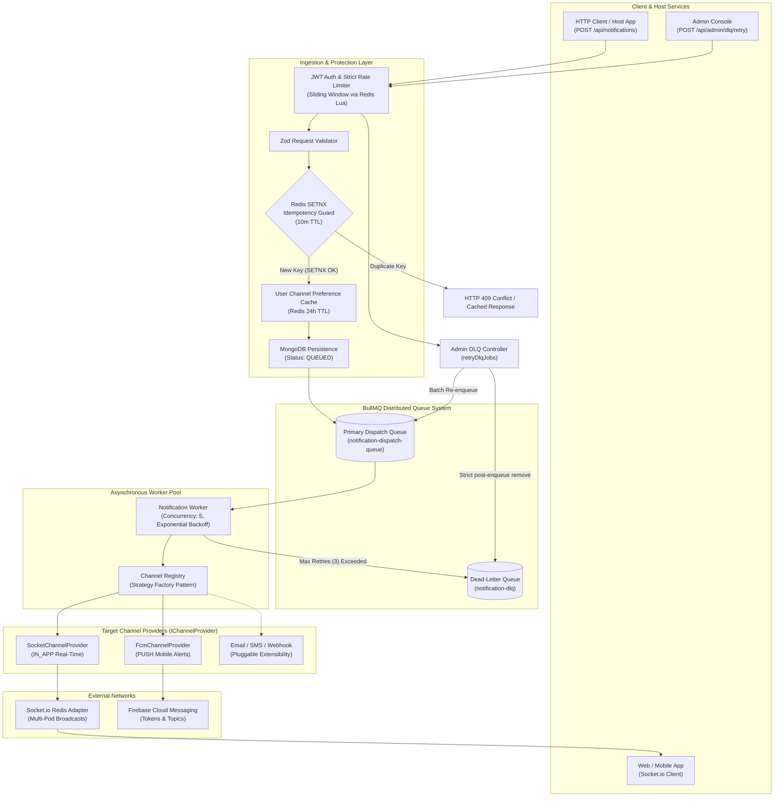

# 🚀 Enterprise Notification Engine

[](https://nodejs.org/)
[](https://expressjs.com/)
[](https://bullmq.io/)
[](https://redis.io/)
[](https://www.mongodb.com/)
[](https://socket.io/)
[](https://firebase.google.com/)

> A high-throughput, fault-tolerant, and domain-agnostic Notification Microservice and SDK built with **Node.js**, **Express**, **MongoDB**, **Redis**, and **BullMQ**. Designed for enterprise scalability using the **Strategy & Registry Pattern**, distributed idempotency controls, atomic rate limiting, and automated Dead-Letter Queue (DLQ) recovery.

---

## 📑 Table of Contents

- [System Architecture Diagram](#-system-architecture-diagram)
- [Key Features](#-key-features)
- [Tech Stack](#-tech-stack)
- [Prerequisites & Installation](#-prerequisites--installation)
- [API Usage Guide](#-api-usage-guide)
  - [Ingest Notification Payload](#1-ingest-notification-dispatch)
  - [Retry Failed Jobs from DLQ](#2-admin-retry-permanently-failed-jobs-from-dlq)
  - [Update Notification Profile & Subscriptions](#3-manage-user-notification-profile)
- [Core Directory Structure](#-core-directory-structure)
- [Testing & Quality Assurance](#-testing--quality-assurance)

---

## 🏛 System Architecture Diagram

The engine decouples notification ingestion from delivery using an asynchronous event-driven queue pipeline. Ingestion requests respond in **<10ms** while workers process multi-channel dispatches with rate-limiting, retries, and telemetry tracking.



---

## 🌟 Key Features

- **Decoupled Strategy & Channel Registry Pattern**: 
  All delivery channels extend an abstract [`IChannelProvider`](file:///home/visun/Public/notification-backup/backend/src/providers/IChannelProvider.js) interface and are managed dynamically by [`ChannelRegistry`](file:///home/visun/Public/notification-backup/backend/src/registry/ChannelRegistry.js). Providers can be registered, queried, or swapped without touching core dispatch pipelines.
- **Distributed Idempotency Guard**:
  Prevents duplicate message processing across concurrent distributed producers using Redis `SETNX` locks with a 10-minute TTL, partitioned by `tenantId`.
- **Cached User Preferences & Fast Pre-filtering**:
  User channel opt-ins (`in_app`, `push`, `email`, `sms`) are cached in Redis with a 24-hour TTL, eliminating database round-trips during high-velocity dispatches.
- **Domain-Agnostic Tag/Topic Pub/Sub**:
  Zero domain leakage: audience targeting is driven entirely by three universal delivery scopes:
  - `UNICAST`: Direct notification to a specific `recipientId` across all registered devices.
  - `MULTICAST`: Fan-out across dynamic audience tags (e.g. `tag:billing`, `tag:driver-tier1`).
  - `BROADCAST`: Platform-wide alerts sent to all active connections and global topic subscribers.
- **Resilient Queue Pipeline with Exponential Backoff**:
  Powered by BullMQ with automated retry attempts (3 attempts, exponential delays: 2s $\rightarrow$ 4s $\rightarrow$ 8s) to gracefully tolerate downstream 3rd-party outages.
- **Automated Dead-Letter Queue (DLQ) & Admin Safe Retry**:
  Permanently failed jobs automatically transition into `notification-dlq` with failure telemetry. An enterprise Admin API (`POST /api/admin/dlq/retry`) allows operators to batch-replay jobs safely with memory-bounded execution ($\le 50$ jobs) and duplicate prevention (`job.remove()` strictly called only after successful re-enqueue).
- **Atomic Rate Limiting with Graceful Fail-Open**:
  Custom sliding-window rate limiters executed atomically via Redis Lua scripts (`safeEvalScript`). Implements graceful degradation—if Redis disconnects, traffic fails open to prevent system downtime.
- **Horizontally Scalable Real-Time Socket Clustering**:
  Socket.io instances synchronize rooms across multiple Kubernetes pods or load-balanced nodes using `@socket.io/redis-adapter`.

---

## 🛠 Tech Stack

| Layer | Technologies | Purpose |
|---|---|---|
| **Runtime & Framework** | Node.js (v20+ / v22+), Express.js 5.x | High-throughput async non-blocking I/O |
| **Distributed Queue** | BullMQ 6.x | Asynchronous background processing, retries, and DLQ |
| **Caching & Locking** | Redis (ioredis 6.x) | Idempotency keys, atomic rate-limiting Lua scripts, preference caches |
| **Primary Persistence** | MongoDB, Mongoose 9.x | ACID-compliant document storage for notification history & profiles |
| **Real-time Delivery** | Socket.io 4.x, `@socket.io/redis-adapter` | Clustered WebSocket room pub/sub |
| **Mobile Push Delivery**| Firebase Admin SDK (FCM) | Device token multi-cast and topic-based push notifications |
| **Validation & Schema** | Zod 4.x | Strict runtime schema validation on body, query, and path parameters |
| **Logging & Telemetry** | Winston 3.x, Custom Metrics Probe | Structured JSON logging with tenant context and `/metrics` probe |

---

## ⚙️ Prerequisites & Installation

### 1. Prerequisites
- **Node.js**: `v20.10.0` or higher
- **MongoDB**: `v6.0` or higher
- **Redis**: `v7.0` or higher
- **Firebase Service Account**: `firebase-service-account.json` (Required for FCM Push)

### 2. Clone and Install Dependencies
```bash
git clone https://github.com/your-username/notification-engine.git
cd notification-engine/backend
npm install
```

### 3. Environment Configuration
Create a `.env` file in the root backend directory:

```env
# Server Configuration
PORT=5000
NODE_ENV=development
CORS_ORIGIN=http://localhost:5173

# Database & Cache
MONGODB_URI=mongodb://localhost:27017/notification_engine
REDIS_URL=redis://localhost:6379

# Security & Authentication
JWT_SECRET=your_super_secret_enterprise_jwt_signing_key_32chars

# Firebase Cloud Messaging
FIREBASE_SERVICE_ACCOUNT_PATH=./firebase-service-account.json
```

### 4. Start the Application

```bash
# Start in development mode (with hot-reload via nodemon)
npm run dev

# Start in production mode
npm start

# Run automated test suite
npm test
```

---

## 📡 API Usage Guide

All mutation endpoints require authentication via JWT Bearer token:
`Authorization: Bearer <your_jwt_token>`

### 1. Ingest Notification Dispatch
`POST /api/notifications` (or SDK `sendNotification(payload)`)

Enqueues a notification into the BullMQ dispatch queue with sub-10ms latency.

```bash
curl -X POST http://localhost:5000/api/notifications \
  -H "Content-Type: application/json" \
  -H "Authorization: Bearer <TOKEN>" \
  -H "x-tenant-id: tenant_corp_a" \
  -d '{
    "title": "Security Alert: Unusual Login Detected",
    "message": "We detected a login from a new device in San Francisco, CA.",
    "scope": "UNICAST",
    "recipientId": "usr_948201a",
    "channels": ["IN_APP", "PUSH"],
    "priority": "high",
    "actionUrl": "https://app.enterprise.com/security/sessions",
    "templateContext": {
      "ipAddress": "192.0.2.1",
      "timestamp": "2026-10-27T00:30:00Z"
    }
  }'
```

#### Response (`HTTP 202 Accepted` / `HTTP 200 OK`)
```json
{
  "status": "success",
  "data": {
    "_id": "671da518e3a5a7b14023c91e",
    "tenantId": "tenant_corp_a",
    "title": "Security Alert: Unusual Login Detected",
    "scope": "UNICAST",
    "recipientId": "usr_948201a",
    "channels": ["IN_APP", "PUSH"],
    "priority": "high",
    "status": "QUEUED",
    "queued": true,
    "jobId": "tenant_tenant_corp_a_notif_671da518e3a5a7b14023c91e_1792842000000"
  }
}
```

---

### 2. Admin: Retry Permanently Failed Jobs from DLQ
`POST /api/admin/dlq/retry`

Safely drains permanently failed jobs from `notification-dlq`, re-enqueues them into `notificationQueue`, and deletes the DLQ entry strictly upon confirmed success.

```bash
curl -X POST http://localhost:5000/api/admin/dlq/retry \
  -H "Content-Type: application/json" \
  -H "Authorization: Bearer <ADMIN_TOKEN>" \
  -d '{
    "limit": 50
  }'
```

#### Response (`HTTP 200 OK`)
```json
{
  "status": "success",
  "message": "Processed 2 DLQ jobs. 2 successfully retried, 0 failed.",
  "data": {
    "totalProcessed": 2,
    "successCount": 2,
    "failureCount": 0,
    "retriedJobs": [
      {
        "dlqJobId": "dlq_4021",
        "newJobId": "tenant_default_notif_671da518_1792842050",
        "notificationId": "671da518e3a5a7b14023c91e",
        "tenantId": "default"
      }
    ],
    "failedJobs": []
  }
}
```

---

### 3. Manage User Notification Profile
`PATCH /api/notifications/profile/:userId/tags`

Updates user subscribed tags with atomic cache invalidation:

```bash
curl -X PATCH http://localhost:5000/api/notifications/profile/usr_948201a/tags \
  -H "Content-Type: application/json" \
  -H "Authorization: Bearer <TOKEN>" \
  -d '{
    "tags": ["tier:enterprise", "team:infrastructure", "alerts:p0"],
    "mode": "replace"
  }'
```

---

## 📂 Core Directory Structure

The project strictly adheres to separation of concerns and Clean Architecture:

```text
backend/
├── server.js                          # Express bootstrap, Socket.io clustering, route registration
├── package.json                       # Module definitions, scripts, dependencies
├── src/
│   ├── index.js                       # Package public entry point & SDK Facade exports
│   ├── NotificationEngineFacade.js    # Embedded SDK orchestration interface
│   │
│   ├── providers/                     # Strategy Pattern: Channel Implementations
│   │   ├── IChannelProvider.js        # Abstract Strategy base class contract
│   │   ├── SocketChannelProvider.js   # Real-time WebSocket room delivery (IN_APP)
│   │   └── FcmChannelProvider.js      # Mobile push notifications via Firebase (PUSH)
│   │
│   ├── registry/                      # Factory & Registry Pattern
│   │   └── ChannelRegistry.js         # Decoupled channel lookup & provider registration
│   │
│   ├── queues/                        # BullMQ Queue Architecture
│   │   └── notificationQueue.js       # Main dispatch queue & Dead-Letter Queue (DLQ)
│   │
│   ├── workers/                       # Distributed Asynchronous Workers
│   │   └── notificationWorker.js      # Job consumer, channel routing, and DLQ routing
│   │
│   ├── controllers/                   # HTTP Controller Layer
│   │   ├── notificationController.js  # Feed retrieval, unread counts, status mutations
│   │   ├── profileController.js       # FCM tokens, preference opt-ins, and tag subscriptions
│   │   └── adminController.js         # DLQ inspection, batch processing, and safe retry
│   │
│   ├── routes/                        # Express API Endpoints
│   │   ├── notificationRoutes.js      # /api/notifications (feed, profiles, simulations)
│   │   └── adminRoutes.js             # /api/admin/dlq (operational management)
│   │
│   ├── middleware/                    # Security, Resilience, & Validation
│   │   ├── authMiddleware.js          # Cryptographic JWT signature verification
│   │   ├── rateLimitMiddleware.js     # Atomic sliding-window Redis Lua rate limiter
│   │   └── validate.js                # Reusable Zod schema parsing middleware
│   │
│   ├── models/                        # Mongoose Data Schemas
│   │   ├── Notification.js            # Core notification persistence entity
│   │   ├── NotificationProfile.js     # User device tokens, preferences, and tags
│   │   └── NotificationReadStatus.js  # Polymorphic per-user read tracking for broadcasts
│   │
│   └── utils/                         # Reusable Shared Services
│       ├── healthCheck.js             # Readiness/Liveness probes for Redis, DB, & BullMQ
│       ├── logger.js                  # Winston structured logging
│       ├── pushNotificationHelper.js  # FCM SDK wrapper with token self-healing
│       ├── rateLimiter.js             # Redis Lua script execution helper
│       └── telemetry.js               # Dispatch latency and throughput metric recording
│
└── tests/                             # Automated Test Suites (node:test)
    ├── dlqRetry.test.js               # DLQ batching, safe removal order, & fault isolation
    ├── notificationValidator.test.js  # Zod schema boundaries and validation coverage
    └── rateLimitMiddleware.test.js    # Atomic Redis Lua script rate limiter and fail-open tests
```

---

## 🧪 Testing & Quality Assurance

The codebase includes comprehensive unit and integration tests using Node's native high-performance test runner (`node:test` + `node:assert/strict`):

```bash
# Run all tests across the suite
npm test

# Run specific suite
node --test tests/dlqRetry.test.js
node --test tests/rateLimitMiddleware.test.js
node --test tests/notificationValidator.test.js
```

### Key Test Coverage Highlights
- **DLQ Safe Recovery**: Confirms that DLQ jobs are **never** removed unless re-enqueueing succeeds, batch limits ($\le 50$) are strictly enforced, and malformed jobs are isolated without crashing the batch.
- **Fail-Open Resilience**: Validates that if Redis goes down, rate limiters gracefully allow requests through rather than dropping customer alerts.
- **Strict Input Validation**: Tests Zod sanitization, unknown key stripping, string trimming, and tag normalization.

---

## 📄 License

This project is licensed under the **ISC License**.
