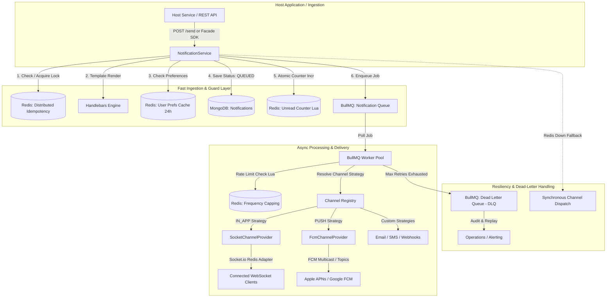

# 🚀 Enterprise Notification Engine

[](https://nodejs.org/)
[](https://expressjs.com/)
[](https://redis.io/)
[](https://bullmq.io/)
[](https://socket.io/)
[](https://www.mongodb.com/)
[](https://firebase.google.com/)
[](#high-level-architecture)
[](LICENSE)

> **Enterprise-grade, multi-tenant notification engine built on a generic Tags/Topics Pub/Sub architecture.** Features asynchronous BullMQ distributed queueing, atomic Redis Lua rate-limiting and idempotency guards, clustered Socket.io real-time streaming, and Firebase Cloud Messaging (FCM) fallback with zero domain leakage.

---

## 📑 Table of Contents

- [Executive Summary](#-executive-summary)
- [High-Level Architecture](#-high-level-architecture)
  - [Design Philosophy: Zero Domain Leakage](#design-philosophy-zero-domain-leakage)
  - [System Flow Diagram](#system-flow-diagram)
  - [Core Audience Scopes](#core-audience-scopes)
- [Tech Stack & Enterprise Justifications](#-tech-stack--enterprise-justifications)
- [End-User Experience & Resilient Delivery](#-end-user-experience--resilient-delivery)
  - [Live WebSocket vs. Offline Push Failover](#live-websocket-vs-offline-push-failover)
  - [Client Reconnection & Topic Reconciliation](#client-reconnection--topic-reconciliation)
  - [Frequency Capping & Alert Fatigue Mitigation](#frequency-capping--alert-fatigue-mitigation)
- [Data Models & Persistence Architecture](#-data-models--persistence-architecture)
  - [Decoupled Subscription Registry (`NotificationProfile`)](#decoupled-subscription-registry-notificationprofile)
  - [Notification Record (`Notification`)](#notification-record-notification)
  - [Polymorphic Read Tracking (`NotificationReadStatus`)](#polymorphic-read-tracking-notificationreadstatus)
- [Developer Integration Guide](#-developer-integration-guide)
  - [1. Programmatic SDK Usage (Embedded Facade)](#1-programmatic-sdk-usage-embedded-facade)
  - [2. REST API Reference](#2-rest-api-reference)
  - [3. Client-Side Socket.io Integration](#3-client-side-socketio-integration)
- [Resiliency, Observability & Operations](#-resiliency-observability--operations)
  - [Distributed Idempotency Guard](#distributed-idempotency-guard)
  - [Atomic Rate Limiting with Redis Lua](#atomic-rate-limiting-with-redis-lua)
  - [Dead Letter Queue (DLQ) & Failure Recovery](#dead-letter-queue-dlq--failure-recovery)
  - [Prometheus Telemetry & Health Probes](#prometheus-telemetry--health-probes)
- [Environment Configuration](#-environment-configuration)
- [Getting Started](#-getting-started)

---

## 🎯 Executive Summary

Modern enterprise architectures demand notification systems that are **loosely coupled**, **fault-tolerant**, and **strictly domain-agnostic**. Hardcoding application concepts—such as user roles, geographic partitions, or product-specific workflows—into a notification layer creates technical debt and prevents reusability across microservices.

This **Notification Engine** acts as a standalone, multi-tenant notification microservice or embeddable SDK. It provides an event-driven pub/sub communication backbone that abstracts away multi-channel complexity across WebSockets, Mobile Push (FCM), Email, SMS, and Webhooks.

### Key Architectural Highlights
- **Sub-10ms Ingestion Latency:** Ingestion endpoints persist initial state, acquire distributed idempotency locks, and hand off processing to background queues asynchronously.
- **Zero Domain Leakage:** All audience segmentation is powered by dynamic string tags (e.g. `role:driver`, `tier:platinum`, `region:eu-central`, `project:alpha`). The engine never evaluates or assumes business logic.
- **Dual-State Multi-Channel Delivery:** Seamlessly orchestrates in-app real-time alerts for active WebSocket sessions and mobile push notifications for backgrounded or offline devices.
- **Enterprise Fault Tolerance:** Guaranteed delivery via BullMQ exponential backoff retries, dead-letter queues (DLQ), and automatic synchronous failover if queues are unreachable.
- **Cross-Instance Synchronization:** Clustered WebSocket horizontal scaling enabled through `@socket.io/redis-adapter`.

---

## 🏛️ High-Level Architecture

### Design Philosophy: Zero Domain Leakage

Traditional systems embed application assumptions directly into notification database schemas (e.g., `isDriver`, `isTourist`, `districtId`). This engine eliminates all domain coupling:
1. **Dynamic Tag-Based Routing:** Clients and backend services subscribe to or dispatch against arbitrary, standardized strings (`namespace:value` or simple alphanumeric tags).
2. **String-Agnostic User Identity:** Recipient identities (`userId`) are handled as plain strings, ensuring drop-in compatibility with MongoDB `ObjectId`, UUIDv4, Clerk, Firebase Auth, or Auth0.
3. **Decoupled Subscription Registry:** User device tokens, preferences, and tags live in an isolated `NotificationProfile` schema, completely separating the notification service from the host application's primary user table.

### System Flow Diagram



### Core Audience Scopes

| Scope | Targeting Mechanism | In-App (Socket.io) Routing | Push (FCM) Routing | Read Tracking Strategy |
| :--- | :--- | :--- | :--- | :--- |
| **`UNICAST`** | Target individual via `recipientId` | Emits to private room: `user_<recipientId>` | Direct dispatch to all registered device tokens for `recipientId` | Direct mutation on `Notification.isRead` + atomic Redis decrement |
| **`MULTICAST`** | Target user segments via `tags: string[]` | Fan-out to rooms: `tag:<tagName>` (Deduplicated via `io.to(rooms).emit()`) | Fan-out to FCM Topics: `tag_<tagName>` | Per-user row in `NotificationReadStatus` (Preserves immutable parent) |
| **`BROADCAST`** | Global dispatch to all active users | System-wide emission via `io.emit()` | Dispatched to reserved FCM Topic: `broadcast_all` | Per-user row in `NotificationReadStatus` (Preserves immutable parent) |

---

## 🛠️ Tech Stack & Enterprise Justifications

```
├── Runtime & Core: Node.js (v20+), Express 5.x
├── Distributed State & Queues: Redis 6.x / 7.x, BullMQ 6.x, ioredis 6.x
├── Real-Time Transport: Socket.io 4.x, @socket.io/redis-adapter
├── Persistence: MongoDB 7.x+, Mongoose 9.x
├── Cloud Messaging: Firebase Admin SDK 14.x (FCM HTTP v1)
└── Telemetry & Health: Prometheus Exporter, Winston Logger
```

### 1. Node.js & Express 5.x
- **Event-Driven Non-Blocking I/O:** Ideal for high-throughput message ingestion and multiplexed network connections without spawning heavyweight operating system threads.
- **Express 5.x Native Promise Resolution:** Eliminates unhandled promise rejection leaks in routing controllers, providing robust middleware chaining and error boundary isolation.

### 2. Redis (ioredis & Node Redis)
- **Distributed Idempotency Guard:** Uses atomic `SET key value EX 600 NX` to eliminate duplicate notifications caused by network retries or client double-submissions.
- **Sliding-Window Frequency Capping via Lua:** Executes single-pass atomic Lua scripts on the Redis engine (`INCR` + conditional `EXPIRE`), preventing alert fatigue while eliminating Time-Of-Check to Time-Of-Use (TOCTOU) race conditions.
- **Cache-Aside Unread Counters:** Tracks per-user unread counts directly in memory with atomic Lua increments/decrements, relieving MongoDB of expensive `countDocuments` queries during feed loads.
- **Distributed Adapter Backbone:** Synchronizes Socket.io rooms across multi-node clusters via Redis Pub/Sub.

### 3. BullMQ (Redis-Backed Queue)
- **Separation of Ingestion & Dispatch:** Isolates high-volume ingestion endpoints from external vendor latency (e.g., Apple APNs or Google FCM throttles).
- **Guaranteed At-Least-Once Delivery:** Configured with exponential backoff retries (`3 attempts`, exponential delay factor `2000ms`).
- **Dead-Letter Queue (DLQ):** Messages exceeding max attempts are isolated in `notification-dlq` with complete failure telemetry, preserving payloads for offline inspection and replay.

### 4. Socket.io 4.x with Clustered Redis Adapter
- **Multi-Room Native Deduplication:** Uses Socket.io v4's `io.to(rooms).emit()`. If a client belongs to multiple matching tags (e.g. `tag:developer` and `tag:beta-tester`), Socket.io deduplicates the socket instance internally, ensuring the user receives exactly **one** packet.
- **Transparent Fallback:** Gracefully degrades from WebSocket transport to HTTP long-polling behind restrictive enterprise proxies.

### 5. MongoDB & Mongoose 9.x
- **Schema Flexibility for Polymorphic Payloads:** Notifications carry heterogeneous payloads (`actionData`, `metadata`, `channels`) without requiring database migrations for each new event type.
- **Compound Multi-Tenant Indexing:** Queries leverage compound indexes (e.g. `{ tenantId: 1, recipientId: 1, createdAt: -1 }`), guaranteeing query plans remain index-bounded ($O(\log N)$) under massive scale.
- **TTL Document Eviction:** Automatic data retention policies enforced through native MongoDB TTL indexes (`expiresAt`), purging stale notifications without cron batch overhead.

### 6. Firebase Cloud Messaging (FCM)
- **Topic-Mirrored Architecture:** FCM topics directly mirror Socket.io tag rooms (`tag_<name>`). Subscribing to a tag on the client synchronizes both live socket rooms and background push topics simultaneously.
- **Multi-Device Support:** Manages multiple device registration tokens per user profile with `$addToSet` deduplication.

---

## 📱 End-User Experience & Resilient Delivery

### Live WebSocket vs. Offline Push Failover

The engine operates on a hybrid live/offline delivery matrix:

```
                      [ Incoming Notification ]
                                  │
                                  ▼
                     [ User Online on Socket? ]
                       /                    \
                     YES                     NO
                     /                        \
        [ Emit via Socket.io ]         [ Suppress In-App Alert ]
        [ Instant UI Toast/Bell ]                 │
                     \                            ▼
                      ───► [ Push Channel Enabled? ]
                                     │
                                     ▼
                        [ Dispatched via FCM HTTP v1 ]
                        [ System Tray / Lock Screen Alert ]
```

1. **Active In-App Experience:** If the user has an active WebSocket session, alerts appear instantly with sub-20ms latency. The client increments its local unread counter in real time without refreshing.
2. **Offline & Background Delivery:** If the user is offline or the mobile app is in the background, the FCM provider delivers a native system push notification. Clicking the push notification opens the deep link specified in `actionUrl`.
3. **Multi-Channel Orchestration:** A single notification can be delivered across multiple providers (`IN_APP`, `PUSH`, `EMAIL`, `SMS`) in parallel via Strategy Pattern providers registered in the `ChannelRegistry`.

### Client Reconnection & Topic Reconciliation

Network handoffs (e.g., switching from Wi-Fi to Cellular) cause temporary socket disconnections:
- **On Handshake:** The server extracts the authenticated `userId` and `tenantId` from the cryptographically verified JWT.
- **Initial Sync:** The gateway fetches the user's active `subscribedTags` from MongoDB (or Redis cache), joins corresponding Socket.io rooms (`tag:<tagName>`), and synchronizes FCM topic subscriptions.
- **Dynamic Diffing:** When the client emits `subscribe_tags` with `{ tags: [...], mode: "replace" }`, the engine computes the set difference (`added` vs `removed`), joining new rooms and leaving stale rooms dynamically.

### Frequency Capping & Alert Fatigue Mitigation

To prevent notification spam:
- Default policy limits push alerts to **5 notifications per recipient per 10-minute window**.
- Enforced atomically using Redis Lua scripting.
- **Priority Override:** Critical notifications (`priority: "high"` or `"critical"`, such as 2FA codes or fraud alerts) bypass the rate limiter automatically.

---

## 🗄️ Data Models & Persistence Architecture

### Decoupled Subscription Registry (`NotificationProfile`)

Stores delivery endpoints, device tokens, and tag preferences without querying the host application's user database.

```javascript
{
  userId: "usr_98a7fbc2",            // External unique user ID (String: UUID, ObjectId, etc.)
  tenantId: "tenant_enterprise_01",  // Tenant boundary
  fcmTokens: [                       // Registered FCM device tokens
    "fcm_token_device_iphone_15",
    "fcm_token_device_macbook_chrome"
  ],
  subscribedTags: [                  // Subscribed audience tags
    "tier:gold",
    "department:finance",
    "region:us-east"
  ],
  preferences: {                     // Per-channel opt-in preferences
    email: true,
    push: true,
    sms: false,
    in_app: true
  },
  createdAt: ISODate("2026-01-15T08:00:00Z"),
  updatedAt: ISODate("2026-02-10T11:20:00Z")
}
```

### Notification Record (`Notification`)

The immutable document representing a dispatched notification.

```javascript
{
  _id: ObjectId("665a1b2c3d4e5f6a7b8c9d0e"),
  tenantId: "tenant_enterprise_01",
  scope: "MULTICAST",                // "UNICAST" | "MULTICAST" | "BROADCAST"
  recipientId: null,                 // Specified only for UNICAST
  tags: ["tier:gold", "feature:beta"], // Audience matching tags
  channels: ["IN_APP", "PUSH"],
  title: "New Premium Feature Available",
  message: "Hi {{name}}, your exclusive access is now unlocked.",
  category: "PRODUCT_UPDATE",
  priority: "normal",                // "low" | "normal" | "high" | "critical"
  status: "DELIVERED",               // "QUEUED" | "PROCESSING" | "DELIVERED" | "PARTIAL" | "FAILED"
  actionUrl: "/features/exclusive",
  metadata: {
    processedAt: ISODate("2026-03-01T10:00:02Z"),
    dispatchResults: [
      { channel: "IN_APP", success: true, targetRooms: ["tag:tier:gold", "tag:feature:beta"] },
      { channel: "PUSH", success: true, targetTopics: ["tag_tier_gold", "tag_feature_beta"] }
    ]
  },
  isRead: false,                     // Used for UNICAST read status
  expiresAt: ISODate("2026-03-31T10:00:00Z") // Automatic TTL eviction
}
```

### Polymorphic Read Tracking (`NotificationReadStatus`)

For `MULTICAST` and `BROADCAST` notifications, a single notification document is displayed to thousands of users. Storing read flags inside the `Notification` record would cause severe database write contention. Instead, the engine utilizes a **polymorphic per-user read receipt table**:

```javascript
{
  tenantId: "tenant_enterprise_01",
  notificationId: ObjectId("665a1b2c3d4e5f6a7b8c9d0e"),
  userId: "usr_98a7fbc2",
  readAt: ISODate("2026-03-01T10:15:30Z"),
  isDeleted: false,
  deletedAt: null
}
```

When fetching a user's notification feed, a MongoDB `$lookup` aggregation joins `NotificationReadStatus` against the notification feed, calculating `isRead` dynamically without mutating the shared parent record.

---

## 💻 Developer Integration Guide

### 1. Programmatic SDK Usage (Embedded Facade)

You can consume the notification engine directly inside an existing Node.js application using the unified `NotificationEngineFacade`.

```javascript
const { initializeNotificationEngine } = require("@enterprise/notification-engine/facade");

async function bootstrap() {
  const engine = await initializeNotificationEngine({
    tenantId: "tenant_acme_corp",
    redisUrl: process.env.REDIS_URL,
    mongoUri: process.env.MONGODB_URI,
    startWorker: true,        // Start BullMQ background workers
    workerConcurrency: 5,     // Concurrent dispatch jobs per node
  });

  // 1. Dispatch a Targeted Multicast Alert
  const result = await engine.sendNotification({
    scope: "MULTICAST",
    tags: ["role:developer", "repo:core-backend"],
    title: "Deployment Pipeline Triggered",
    message: "Pipeline #4321 passed staging tests.",
    category: "CI_CD",
    priority: "high",
    channels: ["IN_APP", "PUSH"],
    actionUrl: "/ci/builds/4321",
  });

  console.log(`Notification enqueued: Job ID ${result.jobId}`);
}
```

---

### 2. REST API Reference

All protected routes require a bearer token in the `Authorization` header:  
`Authorization: Bearer <JWT_TOKEN>`

#### A. Manage User Audience Tags
Assign dynamic audience tags to a user. Used by host applications to control what multicast notifications the user receives.

```http
PATCH /api/notifications/profile/:userId/tags HTTP/1.1
Content-Type: application/json
Authorization: Bearer <TOKEN>
x-tenant-id: tenant_acme_corp

{
  "tags": ["role:engineer", "tier:gold", "region:emea"],
  "mode": "replace"
}
```
*`mode` options:* `"replace"` (overwrites existing tags) or `"merge"` (appends new tags).

#### B. Register FCM Device Token
Registers a device push token for mobile/web push delivery. Idempotent via `$addToSet`.

```http
PATCH /api/notifications/profile/:userId/token HTTP/1.1
Content-Type: application/json
Authorization: Bearer <TOKEN>

{
  "token": "eX_fcm_token_sample_abc123"
}
```

#### C. Ingest / Dispatch Notification (Simulation & Testing)
Dispatches a notification into the engine ingestion pipeline.

```http
POST /api/notifications/simulate-system-update HTTP/1.1
Content-Type: application/json
Authorization: Bearer <TOKEN>

{
  "type": "MULTICAST",
  "scenario": "ALERT",
  "tags": ["tier:gold"],
  "channels": ["IN_APP", "PUSH"],
  "title": "System Maintenance Notice",
  "message": "Maintenance scheduled for 02:00 UTC."
}
```

#### D. Fetch Paginated Notification Feed
Returns the user's unified inbox (personal unicasts + matching tag multicasts + public broadcasts).

```http
GET /api/notifications?page=1&limit=20 HTTP/1.1
Authorization: Bearer <TOKEN>
```

**Response (200 OK):**
```json
{
  "status": "success",
  "page": 1,
  "results": 1,
  "data": [
    {
      "_id": "665a1b2c3d4e5f6a7b8c9d0e",
      "scope": "MULTICAST",
      "tags": ["tier:gold"],
      "title": "System Maintenance Notice",
      "message": "Maintenance scheduled for 02:00 UTC.",
      "category": "ALERT",
      "priority": "high",
      "isRead": false,
      "createdAt": "2026-03-01T10:00:00.000Z"
    }
  ]
}
```

#### E. Mark Notification as Read
Updates read status. UNICAST decrements cached unread counters; MULTICAST records a receipt in `NotificationReadStatus`.

```http
PATCH /api/notifications/665a1b2c3d4e5f6a7b8c9d0e/read HTTP/1.1
Authorization: Bearer <TOKEN>
```

---

### 3. Client-Side Socket.io Integration

Connect your frontend (React, Vue, React Native, or Vanilla JS) to the engine.

```javascript
import { io } from "socket.io-client";

// 1. Establish Authenticated Connection
const socket = io("https://notifications.yourdomain.com", {
  auth: {
    token: userJwtToken, // Cryptographic JWT with { id, tenantId }
  },
  transports: ["websocket", "polling"],
});

// 2. Connection Lifecycle
socket.on("connect", () => {
  console.log("Connected to notification gateway. Socket ID:", socket.id);
});

// 3. Listen for Incoming Notifications
socket.on("new_notification", (notification) => {
  console.log("🔔 New Notification Received:", notification);
  
  // Update UI Store / Display Toast
  displayInAppToast(notification.title, notification.message);
  incrementUnreadBadge();
});

// 4. Dynamically Update Subscribed Tags
function updateUserTags(newTags) {
  socket.emit("subscribe_tags", {
    tags: newTags,     // e.g. ["tier:platinum", "region:na"]
    mode: "replace",   // "replace" | "merge"
  });
}

// 5. Confirmation from Gateway
socket.on("tags_updated", (data) => {
  console.log("Active tag rooms confirmed:", data.subscribedTags);
});

// 6. Handle Error Events
socket.on("error", (err) => {
  console.error("Socket gateway error:", err.message);
});
```

---

## 🛡️ Resiliency, Observability & Operations

### Distributed Idempotency Guard

Network blips often cause clients to retry requests. The engine prevents duplicate ingestion using SHA-256 fingerprinting:
1. Calculates fingerprint: `hash(tenantId + recipientId + scope + title + message + tags)`.
2. Attempts atomic Redis write: `SET tenant:<tenantId>:notif:idempotency:<hash> "PENDING" EX 600 NX`.
3. If the key exists, the request returns immediately with `{ deduplicated: true }`, completely preventing duplicate queueing and delivery.

### Atomic Rate Limiting with Redis Lua

Alert frequency capping is evaluated in the worker pipeline using an atomic Lua script:

```lua
local count = redis.call('INCR', KEYS[1])
if count == 1 then
  redis.call('EXPIRE', KEYS[1], ARGV[1])
end
return count
```
*Why this matters:* Traditional `INCR` followed by `EXPIRE` over two network hops leaves an exploit window if the process crashes before `EXPIRE`, producing immortal keys. Lua guarantees atomic execution on the Redis thread.

### Dead Letter Queue (DLQ) & Failure Recovery

When a job fails across all BullMQ retry attempts (default: 3 attempts with exponential backoff):
1. The worker marks the database status as `FAILED`.
2. The payload, error stack trace, attempt history, and tenant ID are routed to `notification-dlq`.
3. Operations teams can inspect failed jobs via BullMQ tooling or replay messages using administrative scripts once external vendor outages resolve.

### Prometheus Telemetry & Health Probes

The engine exposes dedicated operational probes for Kubernetes liveness and Grafana dashboards:

- **`GET /health/notifications`**: Checks connectivity for Redis, MongoDB, BullMQ worker status, and Socket.io adapter.
- **`GET /api/notifications/metrics`**: Emits standard Prometheus exposition format metrics:
  - `notification_engine_enqueued_total{tenantId}`
  - `notification_engine_dispatched_total{tenantId, channel, status}`
  - `notification_engine_queue_wait_duration_ms{tenantId}`
  - `notification_engine_rate_limited_total{tenantId, channel}`

---

## ⚙️ Environment Configuration

Create a `.env` file in the project root:

```env
# Server
PORT=5000
NODE_ENV=production
CORS_ORIGIN=http://localhost:5173

# Database & Cache
MONGODB_URI=mongodb://localhost:27017/notification_engine
REDIS_URL=redis://localhost:6379

# Authentication
JWT_SECRET=your_super_secret_jwt_signing_key_32_bytes_min

# Firebase Cloud Messaging
# Base64 encoded Service Account JSON or direct environment paths
FIREBASE_SERVICE_ACCOUNT_KEY={"type":"service_account","project_id":"..."}
```

---

## 🚀 Getting Started

### Installation
```bash
git clone https://github.com/your-org/notification-engine.git
cd notification-engine
npm install
```

### Local Development
Ensure local MongoDB and Redis instances are running:
```bash
# Start MongoDB & Redis via Docker
docker run -d -p 27017:27017 --name mongo-local mongo:7.0
docker run -d -p 6379:6379 --name redis-local redis:7.2-alpine

# Run in Development Mode
npm run dev
```

### Running Tests & Health Check
```bash
# Run unit and integration tests
npm test

# Check system health
curl http://localhost:5000/health/notifications
```

---

## 📄 License

This project is licensed under the [ISC License](LICENSE).
