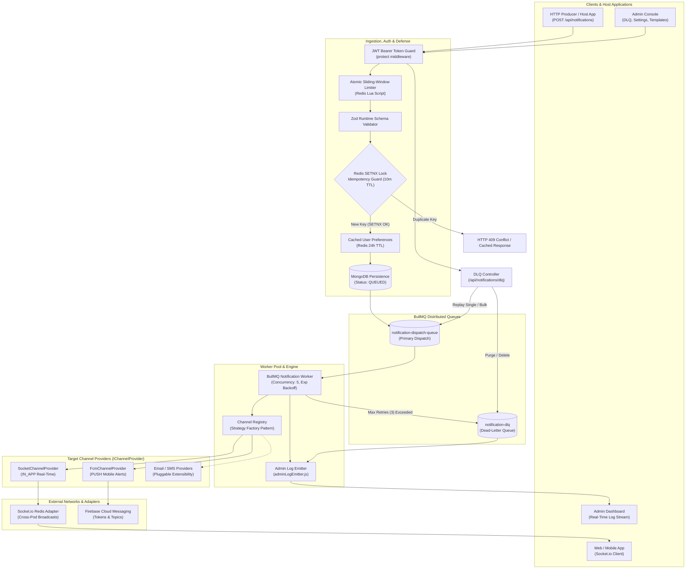

# 🚀 Enterprise Notification Engine

[](https://nodejs.org/)
[](https://pnpm.io/)
[](https://expressjs.com/)
[](https://bullmq.io/)
[](https://redis.io/)
[](https://www.mongodb.com/)
[](https://socket.io/)
[](https://firebase.google.com/)

> A high-throughput, fault-tolerant, and domain-agnostic Notification Microservice and SDK built with **Node.js**, **Express**, **MongoDB (Mongoose)**, **Redis**, and **BullMQ**. Designed for enterprise scalability featuring asynchronous queue pipelines, distributed idempotency controls, Handlebars dynamic templating, channel kill-switches, full Dead-Letter Queue (DLQ) lifecycle management, multi-entity concurrent search, and real-time WebSocket log streaming.

---

## 📑 Table of Contents

- [Overview & Architecture](#-overview--architecture)
- [System Architecture Diagram](#-system-architecture-diagram)
- [Tech Stack & Dependencies](#-tech-stack--dependencies)
- [Core Backend Modules](#-core-backend-modules)
  - [1. Notification Dispatch & Workers](#1-notification-dispatch--workers)
  - [2. Dead-Letter Queue (DLQ) Management](#2-dead-letter-queue-dlq-management)
  - [3. Message Templates (Handlebars Engine)](#3-message-templates-handlebars-engine)
  - [4. Global Settings & Channel Kill-Switches](#4-global-settings--channel-kill-switches)
  - [5. Global Search Controller](#5-global-search-controller)
  - [6. Real-Time Admin Log Emitter](#6-real-time-admin-log-emitter)
- [Environment Variables (.env Setup)](#-environment-variables-env-setup)
- [Getting Started & Running Locally](#-getting-started--running-locally)
- [API Reference](#-api-reference)
  - [Notification Ingestion & Feed](#notification-ingestion--feed)
  - [Dead-Letter Queue (DLQ) Endpoints](#dead-letter-queue-dlq-endpoints)
  - [Notification Templates CRUD](#notification-templates-crud)
  - [System Settings & Channel Switches](#system-settings--channel-switches)
  - [Global Command Palette Search](#global-command-palette-search)
  - [Profile & Subscription Management](#profile--subscription-management)
  - [Health & Telemetry Probes](#health--telemetry-probes)
- [Project Directory Structure](#-project-directory-structure)
- [Testing & Quality Assurance](#-testing--quality-assurance)
- [License](#-license)

---

## 🌐 Overview & Architecture

The **Enterprise Notification Engine** provides a decoupled, distributed notification delivery infrastructure built for high velocity and sub-10ms response times. Producers ingest notifications via REST API or the built-in facade SDK, which persists the payload in MongoDB with `QUEUED` status and pushes jobs into BullMQ Redis queues.

Delivery workers consume jobs concurrently across multiple channels:
- **In-App WebSockets**: High-performance room and tag targeting using clustered Socket.io backed by `@socket.io/redis-adapter`.
- **Push Mobile Notifications**: Direct device token multicast and topic delivery powered by Firebase Cloud Messaging (FCM) with automated dead-token pruning.
- **Extensible Providers**: Clean plug-and-play architecture implementing the **Strategy & Channel Registry Pattern**.

### Key Architectural Pillars
- **Asynchronous Decoupled Ingestion**: HTTP calls return in `<10ms` with job IDs while background workers handle external delivery latencies.
- **Resilient Retry & DLQ Pipeline**: Configurable exponential backoff retries with automatic routing to a dedicated Dead-Letter Queue (`notification-dlq`) when max attempts are exceeded.
- **Dynamic Templating**: Handlebars-backed templates with variable interpolation and fallback values.
- **Centralized System Configuration**: Global switches allowing instant runtime toggling of channels (`inApp`, `push`, `email`, `sms`).
- **Distributed Idempotency & Rate Limiting**: Sliding-window rate limiters executed atomically via Redis Lua scripts with graceful fail-open protection.
- **Operational Visibility**: Real-time admin audit stream over WebSockets (`admin-live-logs`) and concurrent multi-model search.

---

## 🏛 System Architecture Diagram



---

## 🛠 Tech Stack & Dependencies

| Category | Technology | Version | Purpose |
|---|---|---|---|
| **Package Manager** | [pnpm](https://pnpm.io/) | `9.x+` | Fast, disk space-efficient package management and workspace support |
| **Runtime Engine** | [Node.js](https://nodejs.org/) | `v20+` / `v22+` | High-throughput asynchronous non-blocking event-driven runtime |
| **HTTP Framework** | [Express.js](https://expressjs.com/) | `5.x` | RESTful routing, telemetry endpoints, and middleware pipeline |
| **Primary Persistence** | [MongoDB](https://www.mongodb.com/) & [Mongoose](https://mongoosejs.com/) | `9.6+` | ACID document store for notifications, templates, user profiles, settings |
| **Queue & Worker Engine** | [BullMQ](https://bullmq.io/) | `6.x` | Distributed Redis-backed message queue, concurrency control, and DLQ |
| **Distributed Cache & Broker** | [Redis](https://redis.io/) ([ioredis](https://github.com/redis/ioredis)) | `6.x` | Atomic Lua rate limiting, distributed lock (`SETNX`), cache layers |
| **Real-time WebSockets** | [Socket.io](https://socket.io/) / `@socket.io/redis-adapter` | `4.x` / `8.x` | Clustered real-time delivery and horizontal multi-pod room fan-out |
| **Mobile Push Alerts** | [Firebase Admin SDK](https://firebase.google.com/) | `14.x` | FCM mobile push notifications, multicast batches, and topic broadcast |
| **Templating Engine** | [Handlebars](https://handlebarsjs.com/) | `4.7+` | Dynamic template compilation with variable substitution |
| **Validation & Schema** | [Zod](https://zod.dev/) | `4.x` | Type-safe runtime input validation on headers, params, and bodies |
| **Logging & Diagnostics** | [Winston](https://github.com/winstonjs/winston) & [Morgan](https://github.com/expressjs/morgan) | `3.x` | Structured logging with tenant context and HTTP access recording |

---

## 🧩 Core Backend Modules

### 1. Notification Dispatch & Workers
- **Queue Pipeline**: Main queue `notification-dispatch-queue` handles all asynchronous ingestion.
- **Worker Threads**: `notificationWorker.js` runs a concurrent worker pool (`concurrency: 5`) that picks up jobs, manages status transitions (`QUEUED` $\rightarrow$ `PROCESSING` $\rightarrow$ `DELIVERED` / `PARTIAL` / `FAILED`), records wait times, and delivers across channels.
- **Exponential Backoff**: Jobs are configured with 3 automatic retry attempts with exponential backoff delay (2s $\rightarrow$ 4s $\rightarrow$ 8s) to mitigate downstream spikes or transient network failures.

### 2. Dead-Letter Queue (DLQ) Management
- **Automatic Routing**: Jobs exceeding the retry budget are caught by worker failure handlers and routed into `notification-dlq`.
- **Operational Endpoints** (`/api/notifications/dlq`):
  - `GET /`: Lists all waiting and failed DLQ jobs with pagination and parsed error payloads.
  - `POST /:jobId/retry`: Atomically re-enqueues a specific failed job into the active dispatch queue and purges it from the DLQ upon success.
  - `POST /retry-all`: Batch retries up to 50 jobs with memory safety and error isolation.
  - `DELETE /:jobId`: Permanently deletes an individual dead-letter job.
  - `DELETE /clear-all`: Flushes and purges all dead-letter jobs.

### 3. Message Templates (Handlebars Engine)
- **Blueprint Management** (`/api/notifications/templates`):
  - Provides CRUD endpoints for template creation, retrieval, updates, and deletion.
  - Supports categories: `SYSTEM`, `SECURITY`, `BOOKING`, `PROMOTION`, `GENERAL`.
  - Built-in Handlebars syntax compilation: compiles dynamic tokens like `{{userName}}`, `{{orderId}}`, or `{{location}}` into subjects and bodies.
  - Auto-seeds default starter templates for new tenants upon first boot.

### 4. Global Settings & Channel Kill-Switches
- **Runtime Configuration** (`/api/notifications/settings`):
  - Dynamic master switches for delivery channels (`inApp`, `push`, `email`, `sms`).
  - Queue tuning parameters (e.g., `maxRetries`, `backoffDelayMs`).
  - Rate limiting thresholds (sliding-window requests per minute).
  - Retention policies and provider credential management with masked secrets.

### 5. Global Search Controller
- **Concurrent Multi-Entity Search** (`/api/notifications/search?q={query}`):
  - Simultaneously searches across four internal entities using `Promise.all`:
    1. **Notifications**: Matches title, message, status, category, recipient ID, or ObjectId.
    2. **Templates**: Matches template name, subject, or category.
    3. **User Profiles**: Matches user IDs and subscribed audience tags.
    4. **DLQ Jobs**: Scans waiting and failed queue jobs for job IDs, error reasons, and titles.
  - Designed specifically to back instant command palettes (`Cmd+K` / `Ctrl+K`).

### 6. Real-Time Admin Log Emitter
- **WebSocket Streaming Utility** (`src/utils/adminLogEmitter.js`):
  - Maintains an in-memory ring buffer (last 100 log items) for immediate dashboard hydration.
  - Broadcasts structured operational events over the `admin-live-logs` Socket.io channel:
    - `JOB_PROCESSING`: Worker thread picks up a dispatch.
    - `NOTIFICATION_DELIVERED`: Dispatch completed successfully.
    - `ROUTED_TO_DLQ`: Job exceeded retry budget and moved to DLQ.
    - `DLQ_JOB_RETRIED` & `DLQ_BULK_RETRIED`: Manual or automated replay triggered.
    - `SETTINGS_UPDATED` & `TEMPLATE_CREATED`: System configurations modified.

---

## ⚙️ Environment Variables (.env Setup)

Create a `.env` file in the `backend/` directory by duplicating `.env.example`:

```bash
cp .env.example .env
```

| Key | Type | Default / Example | Description |
|---|---|---|---|
| `PORT` | `Number` | `5000` | Port for the Express HTTP and WebSocket server |
| `NODE_ENV` | `String` | `development` | Runtime environment (`development`, `production`, `test`) |
| `MONGODB_URI` / `MONGO_URI` | `String` | `mongodb://localhost:27017/notification_engine` | MongoDB connection URI with optional database name |
| `REDIS_URL` | `String` | `redis://localhost:6379` | Redis connection URL for queues, adapter, and cache |
| `CORS_ORIGIN` | `String` | `http://localhost:5173` | Allowed CORS origins for browser web applications |
| `JWT_SECRET` | `String` | `your_super_secret_jwt_key_here` | 256-bit secret used for signing and verifying user tokens |
| `FIREBASE_SERVICE_ACCOUNT_PATH` | `String` | `./firebase-service-account.json` | Relative or absolute path to Firebase Admin credentials JSON |

### Sample `.env` File
```env
PORT=5000
NODE_ENV=development
CORS_ORIGIN=http://localhost:5173

# Database & Cache
MONGODB_URI=mongodb://localhost:27017/notification_engine
REDIS_URL=redis://localhost:6379

# Security & Authentication
JWT_SECRET=your_super_secret_enterprise_jwt_key_here

# Firebase Push Credentials
FIREBASE_SERVICE_ACCOUNT_PATH=./firebase-service-account.json
```

> **Firebase Configuration Note**: Ensure `firebase-service-account.json` exists in the backend root if push notifications are enabled. A template is provided at `firebase-service-account.example.json`.

---

## 🚀 Getting Started & Running Locally

### 1. Prerequisites
- **Node.js**: `v20.10.0` or higher
- **pnpm**: `v9.0.0` or higher (`npm install -g pnpm`)
- **MongoDB**: `v6.0+` running locally or via cloud URI
- **Redis**: `v7.0+` running locally (`redis-server`) or in Docker

### 2. Quick Infrastructure Setup with Docker (Optional)
If you don't have local MongoDB and Redis instances running:
```bash
# Run Redis
docker run -d --name redis-notify -p 6379:6379 redis:7-alpine

# Run MongoDB
docker run -d --name mongo-notify -p 27017:27017 mongo:7
```

### 3. Install Dependencies with `pnpm`
```bash
# Navigate to the backend directory
cd backend

# Install all dependencies using pnpm
pnpm install
```

### 4. Run the Application

```bash
# Start in development mode with nodemon hot-reloading
pnpm run dev

# Start in production mode
pnpm start

# Run the automated test suite
pnpm test
```

When started, you should see console logs confirming:
- Connected to MongoDB database
- Attached distributed Redis adapter to Socket.io
- Worker started listening to `notification-dispatch-queue`
- Server running on `http://localhost:5000`

---

## 📡 API Reference

Base URL: `http://localhost:5000/api`

All endpoints (except telemetry `/health` and `/metrics`) require the standard Authorization header:
```http
Authorization: Bearer <your_jwt_token>
```
You can also supply tenant identification via the optional header:
```http
x-tenant-id: tenant_company_a
```

---

### Notification Ingestion & Feed

#### Ingest / Dispatch Notification
`POST /api/notifications`

```bash
curl -X POST http://localhost:5000/api/notifications \
  -H "Content-Type: application/json" \
  -H "Authorization: Bearer <TOKEN>" \
  -H "x-tenant-id: default" \
  -d '{
    "title": "Deployment Finished",
    "message": "Service cluster v2.4.0 successfully rolled out.",
    "scope": "UNICAST",
    "recipientId": "user_12345",
    "channels": ["IN_APP", "PUSH"],
    "priority": "high",
    "category": "SYSTEM",
    "actionUrl": "https://dashboard.example.com/deployments"
  }'
```

**Response (`202 Accepted` / `200 OK`):**
```json
{
  "status": "success",
  "data": {
    "_id": "67210e3fa123b0c498a5e110",
    "tenantId": "default",
    "title": "Deployment Finished",
    "scope": "UNICAST",
    "recipientId": "user_12345",
    "channels": ["IN_APP", "PUSH"],
    "priority": "high",
    "status": "QUEUED",
    "queued": true,
    "jobId": "tenant_default_notif_67210e3fa123b0c498a5e110_1730200000000"
  }
}
```

#### Fetch Notification Feed
`GET /api/notifications?page=1&limit=20`

#### Get Unread Count
`GET /api/notifications/unread-count`

#### Mark Single as Read
`PATCH /api/notifications/:id/read`

#### Mark All Read
`PATCH /api/notifications/mark-all-read`

---

### Dead-Letter Queue (DLQ) Endpoints

#### List DLQ Jobs
`GET /api/notifications/dlq?page=1&limit=20`

**Response (`200 OK`):**
```json
{
  "status": "success",
  "results": 1,
  "pagination": {
    "page": 1,
    "limit": 20,
    "totalPages": 1,
    "totalCount": 1
  },
  "data": {
    "jobs": [
      {
        "id": "14",
        "name": "dead-letter-job",
        "originalJobId": "tenant_default_notif_102",
        "notificationId": "67210e3fa123b0c498a5e110",
        "tenantId": "default",
        "failedReason": "Firebase registration token is expired",
        "failedAt": "2026-10-29T14:20:00.000Z",
        "attemptsMade": 3,
        "payload": { "title": "Deployment Finished" }
      }
    ],
    "totalCount": 1
  }
}
```

#### Replay Specific DLQ Job
`POST /api/notifications/dlq/:jobId/retry`

#### Bulk Replay DLQ Jobs
`POST /api/notifications/dlq/retry-all`

#### Delete Specific DLQ Job
`DELETE /api/notifications/dlq/:jobId`

#### Clear Entire DLQ
`DELETE /api/notifications/dlq/clear-all`

---

### Notification Templates CRUD

#### List Templates
`GET /api/notifications/templates?category=ALL&search=security`

#### Create Template
`POST /api/notifications/templates`

```bash
curl -X POST http://localhost:5000/api/notifications/templates \
  -H "Content-Type: application/json" \
  -H "Authorization: Bearer <TOKEN>" \
  -d '{
    "name": "login_alert",
    "category": "SECURITY",
    "channels": ["IN_APP", "PUSH"],
    "subject": "New login detected on {{deviceName}}",
    "body": "Hi {{userName}}, we detected a login from {{ipAddress}} at {{timestamp}}.",
    "sampleData": {
      "userName": "Visun",
      "deviceName": "MacBook Pro",
      "ipAddress": "192.168.1.1",
      "timestamp": "19:00 UTC"
    }
  }'
```

#### Update Template
`PUT /api/notifications/templates/:id`

#### Delete Template
`DELETE /api/notifications/templates/:id`

---

### System Settings & Channel Switches

#### Fetch System Configuration
`GET /api/notifications/settings`

#### Update Channel Kill-Switches & Queue Policies
`PUT /api/notifications/settings`

```bash
curl -X PUT http://localhost:5000/api/notifications/settings \
  -H "Content-Type: application/json" \
  -H "Authorization: Bearer <TOKEN>" \
  -d '{
    "channels": {
      "inApp": true,
      "push": true,
      "email": false,
      "sms": false
    },
    "queue": {
      "maxRetries": 3,
      "backoffDelayMs": 2000
    },
    "rateLimits": {
      "requestsPerMinute": 120
    }
  }'
```

---

### Global Command Palette Search

`GET /api/notifications/search?q={query}`

```bash
curl -X GET "http://localhost:5000/api/notifications/search?q=security" \
  -H "Authorization: Bearer <TOKEN>"
```

**Response (`200 OK`):**
```json
{
  "status": "success",
  "data": {
    "query": "security",
    "counts": {
      "notifications": 1,
      "templates": 1,
      "dlq": 0,
      "users": 0
    },
    "results": {
      "notifications": [
        {
          "_id": "67210e3fa123b0c498a5e110",
          "title": "Security Alert: New Session",
          "status": "DELIVERED",
          "priority": "high",
          "category": "SECURITY"
        }
      ],
      "templates": [
        {
          "_id": "67210e3fa123b0c498a5e999",
          "name": "security_alert",
          "category": "SECURITY",
          "subject": "🚨 Security Alert: New Login from {{location}}"
        }
      ],
      "dlq": [],
      "users": []
    }
  }
}
```

---

### Profile & Subscription Management

- `PATCH /api/notifications/profile/:userId/token`: Register FCM device token.
- `DELETE /api/notifications/profile/:userId/token`: Remove FCM token on logout.
- `PATCH /api/notifications/profile/:userId/preferences`: Update per-channel opt-ins.
- `PATCH /api/notifications/profile/:userId/tags`: Merge or replace subscribed audience tags.

---

### Health & Telemetry Probes

- `GET /health`: Comprehensive infrastructure probe checking MongoDB readiness, Redis connection latency, and BullMQ worker responsiveness.
- `GET /metrics`: Aggregated Prometheus-compatible telemetry stats on dispatch latency, throughput, and error rates.
- `GET /overview`: High-level operational summary for admin dashboards.

---

## 📂 Project Directory Structure

```text
backend/
├── server.js                          # Express bootstrap, Socket.io clustering, route mounting
├── package.json                       # Service metadata, scripts, and dependencies
├── pnpm-lock.yaml                     # Deterministic pnpm dependency lockfile
├── pnpm-workspace.yaml                # pnpm workspace configuration
├── .env.example                       # Environment variables specification
├── firebase-service-account.example.json # FCM service account structure template
│
├── socket/
│   └── notificationHandler.js         # Socket.io connection logic & room joining
│
├── src/
│   ├── index.js                       # Public package entry point & SDK facade exports
│   ├── NotificationEngineFacade.js    # Programmatic SDK facade for embedded services
│   │
│   ├── config/
│   │   ├── firebaseConfig.js          # Firebase Admin SDK singleton initialization
│   │   └── redisClient.js             # Distributed Redis pub/sub clients & adapter
│   │
│   ├── constants/
│   │   └── notificationConstants.js   # Scopes, statuses, channels, and priorities
│   │
│   ├── controllers/                   # REST API Controllers
│   │   ├── adminController.js         # DLQ batch recovery operations
│   │   ├── dlqController.js           # Full DLQ lifecycle: list, single/bulk retry, purge
│   │   ├── exampleController.js       # Live simulation triggers
│   │   ├── notificationController.js  # Notification feed, mark-as-read, metrics, overview
│   │   ├── profileController.js       # FCM tokens, user channel preferences, tag subscriptions
│   │   ├── searchController.js        # Concurrent multi-model search controller
│   │   ├── settingsController.js      # Global system settings & channel kill-switches
│   │   └── templateController.js      # Handlebars message template CRUD
│   │
│   ├── middleware/                    # HTTP & Socket Middleware Pipeline
│   │   ├── authMiddleware.js          # Cryptographic JWT verification for REST routes
│   │   ├── errorMiddleware.js         # Centralized error handler with MongoDB normalization
│   │   ├── rateLimitMiddleware.js     # Atomic sliding-window Redis Lua rate limiter
│   │   ├── socketAuthMiddleware.js    # JWT handshake verification for Socket.io
│   │   └── validate.js                # Generic Zod validation runner for request payloads
│   │
│   ├── models/                        # Mongoose Database Schemas
│   │   ├── Notification.js            # Core notification record & dispatch history
│   │   ├── NotificationProfile.js     # User device tokens, channel preferences, & tags
│   │   ├── NotificationReadStatus.js  # Polymorphic per-user read tracking for broadcasts
│   │   ├── NotificationTemplate.js    # Handlebars-supported message template definitions
│   │   └── SystemSettings.js          # System configs, channel kill-switches, & queue policies
│   │
│   ├── providers/                     # Channel Implementations (Strategy Pattern)
│   │   ├── IChannelProvider.js        # Base interface contract for delivery channels
│   │   ├── SocketChannelProvider.js   # Real-time In-App WebSocket provider
│   │   └── FcmChannelProvider.js      # Mobile push notification provider via FCM
│   │
│   ├── queues/                        # BullMQ Queues
│   │   └── notificationQueue.js       # Primary dispatch queue & dead-letter queue definitions
│   │
│   ├── registry/                      # Strategy Factory & Registry
│   │   └── ChannelRegistry.js         # Central registry for delivery channel providers
│   │
│   ├── routes/                        # Express API Routes
│   │   ├── adminRoutes.js             # /api/admin privileged endpoints
│   │   └── notificationRoutes.js      # /api/notifications core endpoints
│   │
│   ├── services/                      # Domain Business Logic
│   │   └── NotificationService.js     # Ingestion orchestration, idempotency, & enqueuing
│   │
│   ├── utils/                         # Shared Utilities & Helpers
│   │   ├── adminLogEmitter.js         # WebSocket live operational log emitter
│   │   ├── catchAsync.js              # Express async error wrapper
│   │   ├── healthCheck.js             # MongoDB, Redis, and Worker latency probes
│   │   ├── logger.js                  # Winston structured logging utility
│   │   ├── pushNotificationHelper.js  # FCM SDK dispatch wrapper & token cleanup
│   │   ├── rateLimiter.js             # Redis Lua script execution helper
│   │   └── telemetry.js               # Latency, wait time, and throughput metrics
│   │
│   ├── validators/                    # Runtime Schema Validation
│   │   └── notificationValidator.js   # Zod schemas for dispatches, tokens, and preferences
│   │
│   └── workers/                       # BullMQ Background Worker Pool
│       └── notificationWorker.js      # Worker threads, retry logic, channel routing, DLQ routing
│
└── tests/                             # Automated Test Suites (Node Native Test Runner)
    ├── dlqRetry.test.js               # DLQ batching, safe removal order, & fault isolation
    ├── notificationValidator.test.js  # Zod schema boundaries & input sanitization
    └── rateLimitMiddleware.test.js    # Redis Lua atomic rate limiting & fail-open resilience
```

---

## 🧪 Testing & Quality Assurance

The test suite runs on Node's native runner (`node:test` + `node:assert/strict`) without heavy external test framework overhead.

```bash
# Run all tests using pnpm
pnpm test

# Run individual test files
node --test tests/dlqRetry.test.js
node --test tests/notificationValidator.test.js
node --test tests/rateLimitMiddleware.test.js
```

### Key Verification Scenarios
- **Safe DLQ Removal**: Guarantees DLQ jobs are **never** removed unless re-enqueueing succeeds, isolating failures during batch execution.
- **Fail-Open Resilience**: Proves that if Redis is temporarily unreachable, rate limiters gracefully allow requests through to prevent alert dropping.
- **Strict Validation**: Validates Zod boundary guards against prototype pollution, malformed arrays, invalid scopes, and unescaped strings.

---

## 📄 License

This project is licensed under the **ISC License**.
